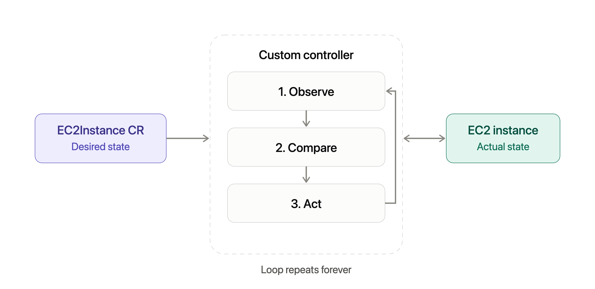
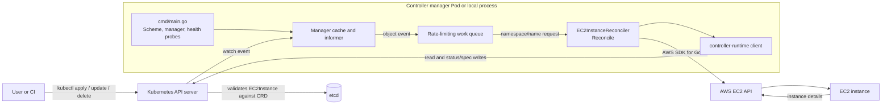
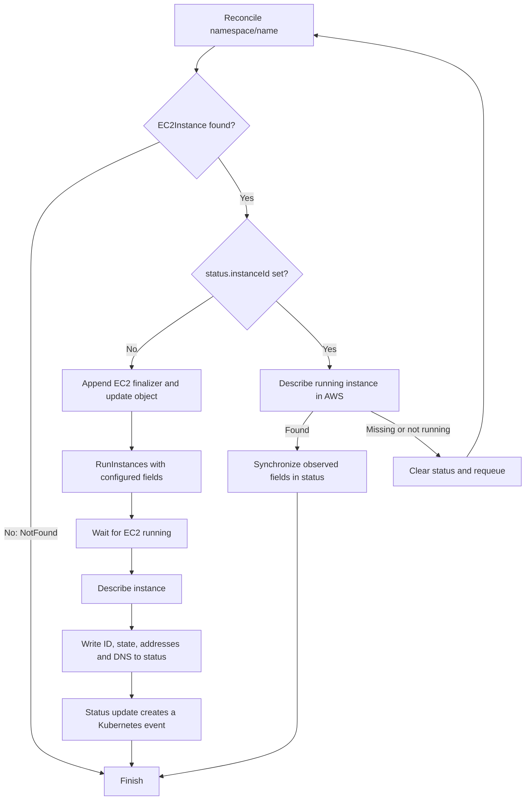

# Kubernetes EC2 Operator

A Kubernetes operator that provisions and observes AWS EC2 instances through the
`EC2Instance` custom resource. It is built with Kubebuilder and
controller-runtime.

> **Development status:** this project is an educational work in progress. Test
> it only in a non-production AWS account. Creating an `EC2Instance` can incur
> AWS charges.

## How it works

Apply an `EC2Instance` resource to the cluster and the controller calls the AWS
EC2 API to launch one instance. It writes the EC2 ID, state, IP addresses, and
DNS names back to `.status`. On later reconciliations it checks the instance in
AWS; if the instance is no longer running, it clears the status and attempts to
create a replacement.



## Architecture and internal flow

The diagram below shows the controller-runtime building blocks that Kubebuilder
scaffolds around the custom reconciliation logic. In this repository,
`cmd/main.go` creates the manager and `internal/controller/ec2instance_controller.go`
provides the reconciler.


### This operator's architecture



There are two conversations in the diagram:

- Kubernetes is the source of the desired state. The `EC2Instance` object is
  persisted in etcd and changes are delivered to the controller through a
  watch, cache, and work queue.
- AWS is the source of EC2's observed state. The reconciler calls `RunInstances`
  and `DescribeInstances`, then records selected observations in the
  Kubernetes object's status subresource.

### From manifest to reconcile request

1. A user submits an `EC2Instance` manifest with `kubectl apply`.
2. The Kubernetes API server authenticates and authorizes the request, then
   validates it against the installed `compute.cloud.com/v1` CRD's OpenAPI
   schema. The currently generated schema requires `amiId`, `instanceType`,
   and `region`.
3. Kubernetes persists the resource in etcd and emits an add or update event.
4. The controller-runtime manager's shared informer receives the event and
   keeps its local cache current.
5. `SetupWithManager` registers a controller for `EC2Instance` through
   `.For(&computev1.EC2Instance{})`. The controller turns the event into a
   `ctrl.Request` containing just the object's namespace and name, and adds it
   to a rate-limiting work queue.
6. A controller worker calls `Reconcile(ctx, request)`. The reconciler gets a
   current `EC2Instance` through the manager client. Reads normally use the
   cache; updates go to the API server.

The queue coalesces duplicate requests and retries a reconciliation with
backoff when `Reconcile` returns an error. It does not continuously poll AWS on
its own; a new reconcile is normally caused by a Kubernetes event, including a
status update made by the controller itself.

### What `Reconcile` does today



In implementation terms:

- If `status.instanceId` is empty, the controller appends
  `ec2instance.compute.cloud.com` to `metadata.finalizers`, launches an EC2
  instance, waits up to three minutes for it to be running, describes it, and
  writes its identifiers and network details to `.status`.
- If `status.instanceId` is present, it uses `DescribeInstances` with a
  `running` state filter. A running instance has its observed state and network
  information synchronized to status. A missing or non-running instance causes
  the controller to clear status and requeue, so a later reconciliation can
  create a replacement.
- A status write uses the CRD's `/status` subresource. This keeps observed
  state separate from the user's desired state in `.spec` and generates another
  watch event.

### Kubebuilder capabilities used here

| Capability | Where it is used | What it provides |
| --- | --- | --- |
| API scaffolding | `api/v1/ec2instance_types.go` | Go types for `EC2Instance`, `EC2InstanceList`, spec, and status. |
| Markers and code generation | API type markers and `make manifests generate` | The CRD, status subresource, RBAC manifests, and DeepCopy methods. |
| Scheme registration | `cmd/main.go` | Registers core Kubernetes types and `compute.cloud.com/v1` types so the client can encode and decode them. |
| Controller manager | `cmd/main.go` | Owns the shared cache/client, controller lifecycle, optional leader election, metrics server, and graceful shutdown. |
| Controller builder | `SetupWithManager` | Watches `EC2Instance` resources and dispatches work to this reconciler. |
| Kubernetes client | `EC2InstanceReconciler.Client` | Gets resources and updates metadata or the status subresource. |
| RBAC markers | `internal/controller/ec2instance_controller.go` | Generates least-privilege Kubernetes permissions for the custom resource, its status, and finalizers. |
| Kustomize deployment | `config/` and Makefile targets | Installs CRDs and deploys the manager, ServiceAccount, RBAC, probes, and metrics configuration. |
| Test scaffolding | `internal/controller/*_test.go`, `test/e2e/` | Envtest-based controller tests and isolated Kind end-to-end tests. |

The manager is configured with health (`/healthz`) and readiness (`/readyz`)
endpoints. It also creates a webhook server and supports secure metrics, but
this project has no registered defaulting, validating, or conversion webhook;
CRD schema validation is the active admission protection.

### Repository map

| Path | Responsibility |
| --- | --- |
| `cmd/main.go` | Starts the manager, registers the API scheme, configures probes, metrics, and the controller. |
| `api/v1/ec2instance_types.go` | Defines the public custom-resource API. |
| `internal/controller/ec2instance_controller.go` | Implements reconciliation and Kubernetes status/metadata updates. |
| `internal/controller/aws_client.go` | Builds the AWS EC2 client from the configured region and environment credentials. |
| `internal/controller/createinstance.go` | Launches an EC2 instance and retrieves its initial observed data. |
| `internal/controller/checkinstance.go` | Looks up a previously created instance. |
| `config/` | Generated and Kustomize-managed CRD, RBAC, manager, and default deployment manifests. |
| `kubernetes/ec2Instance.yaml` | Illustrative `EC2Instance` manifest. |

## API

The custom resource is namespaced and uses:

```yaml
apiVersion: compute.cloud.com/v1
kind: EC2Instance
```

### Spec fields

| Field | Type | Description |
| --- | --- | --- |
| `amiId` | string | AMI used to launch the instance. |
| `instanceType` | string | EC2 instance type, such as `t3.micro`. |
| `region` | string | AWS region in which the controller creates the EC2 client. |
| `availabilityZone` | string | Desired availability zone. |
| `keyPair` | string | Existing EC2 key-pair name. |
| `securityGroups` | string array | Desired security-group IDs. |
| `subnet` | string | Subnet ID for the instance. |
| `userData` | string | Desired EC2 user-data script. |
| `tags` | map of strings | Desired resource tags. |
| `storage.rootVolume` | object | Root-volume configuration. |
| `storage.additionalVolumes` | object array | Additional-volume configuration. |
| `associatePublicIP` | boolean | Desired public-IP association setting. |

Each volume supports `size` (GiB), `type` (for example `gp3`), `deviceName`,
and `encrypted`.

### Status fields

The controller sets `instanceId`, `state`, `publicIP`, `privateIP`,
`publicDNS`, and `privateDNS`. The API also defines `launchTime`, although the
current controller does not populate it.

## Example

Save the following as `ec2instance.yaml`, replacing every placeholder with
resources from your AWS account:

```yaml
apiVersion: compute.cloud.com/v1
kind: EC2Instance
metadata:
  name: demo-web-server
  namespace: default
spec:
  amiId: ami-0123456789abcdef0
  instanceType: t3.micro
  region: eu-central-1
  keyPair: my-existing-key-pair
  subnet: subnet-0123456789abcdef0
  securityGroups:
    - sg-0123456789abcdef0
  tags:
    Name: demo-web-server
    ManagedBy: kubernetes-ec2-operator
  storage:
    rootVolume:
      size: 20
      type: gp3
      encrypted: true
```

An extended illustrative manifest is available at
[`kubernetes/ec2Instance.yaml`](kubernetes/ec2Instance.yaml).

## Prerequisites

- Go 1.26 or later (see `go.mod`)
- Docker, if building a controller image
- `kubectl` configured for the target cluster
- Access to an AWS account, VPC subnet, AMI, and optional EC2 key pair
- AWS credentials available to the controller as `AWS_ACCESS_KEY_ID` and
  `AWS_SECRET_ACCESS_KEY`

Use credentials with only the permissions required for the current controller,
such as `ec2:RunInstances` and `ec2:DescribeInstances`, and restrict them to a
dedicated development account where possible. Never commit credentials to this
repository or put them in a custom resource manifest.

For local development, export credentials before running the controller:

```sh
export AWS_ACCESS_KEY_ID=<access-key-id>
export AWS_SECRET_ACCESS_KEY=<secret-access-key>
make run
```

For an in-cluster deployment, provide the same variables to the controller
manager using a Kubernetes Secret and your deployment overlay. Prefer a
workload identity/role-based approach when the controller is updated to support
the default AWS credential provider chain.

## Install and run

### Local controller

Install the CRD, then run the controller against the current Kubernetes
context:

```sh
make install
make run
```

In another terminal, create and inspect an instance:

```sh
kubectl apply -f ec2instance.yaml
kubectl get ec2instances
kubectl get ec2instance demo-web-server -o yaml
```

### Deploy to a cluster

Build and push an image accessible to the cluster, then deploy it:

```sh
make docker-build docker-push IMG=<registry>/kubernetes-ec2-operator:<tag>
make install
make deploy IMG=<registry>/kubernetes-ec2-operator:<tag>
```

Before creating an `EC2Instance`, configure the deployed manager with AWS
credentials as described above. View controller logs with:

```sh
kubectl logs -n custom-kubernetes-operator-system \
  deployment/custom-kubernetes-operator-controller-manager -c manager -f
```

The namespace and deployment name come from the generated Kustomize manifests;
confirm them with `kubectl get deployments -A` if you customize the overlays.

## Current implementation notes

The API is broader than the present AWS request implementation. Today, the
controller passes only `amiId`, `instanceType`, `keyPair`, and `subnet` to
`RunInstances`. `availabilityZone`, `securityGroups`, `userData`, `tags`,
`storage`, and `associatePublicIP` are accepted by the CRD but are not yet
applied to AWS.

Deletion is not safe yet: the controller adds an EC2 finalizer but does not
implement the corresponding termination and finalizer-removal workflow. Do not
delete `EC2Instance` resources during normal testing unless you understand how
to recover a resource stuck in `Terminating` and how to terminate the EC2
instance manually. The project also does not yet reconcile changes to an
existing instance's desired configuration.

## Development

```sh
make manifests generate  # regenerate CRD and DeepCopy code after API changes
make fmt                 # format Go sources
make vet                 # run static checks
make test                # run unit and envtest tests
make build               # build bin/manager
```

Run end-to-end tests only against the dedicated Kind cluster created by the
Makefile:

```sh
make test-e2e
```

Use `make help` to list all targets. Generated files under `config/crd/bases/`,
`config/rbac/role.yaml`, and `api/v1/zz_generated.deepcopy.go` should be
updated through the Makefile targets rather than edited directly.

## Uninstall

After manually verifying that no managed EC2 instances remain, remove the
controller and CRD:

```sh
make undeploy
make uninstall
```

## License

Copyright 2026. Licensed under the Apache License, Version 2.0.
